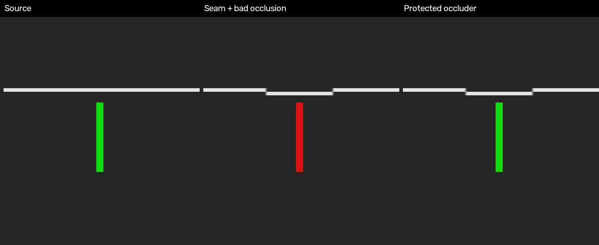

# 先判断能否贴回，再做精细成片

新增 `merge --structure-preview`，把结构试贴作为独立的检查材料。目标是尽早判断接缝错位、双轮廓、遮挡关系和时间对应是否值得继续修。检查阶段允许色差；正式成片仍使用原配置及完整验收标准。

## 行为与取舍

- 按所选区间内所有有映射补丁的裁切框运动并集，四周加64源像素参照，输出原像素局部视频。偶数边界保持源色度网格；片边截断。保留原帧率、原映射及全部所选帧，不跳帧／缩放／自动补帧。
- 只把融合改成alpha，固定BGR调色改成恒等。空间变换、工作尺寸、遮罩、保护区、淡变及null／重复帧都沿用原配置。原配置先按既有导出范围验证，避免简化步骤掩盖错误参数；选段的逐帧检查范围仍限于所导出的帧，配置文件不改写。
- FFmpeg先在全尺寸转换到YUV444，再裁切后输出给Python。这样减少管道载荷和局部帧内存，并保留与全尺寸色度插值相同的样本；不宣称只解码了局部码流。RGB源也支持局部视窗。
- 输入探测缓存、严格输出全解码、尺寸／帧数／fps、整段原音轨载荷核对和发布前校验均保留。选段音轨仍裁切并重编码。与原检查片一样不生成正式视觉验收记录。
- 报告同时记录原配置与实际检查配置，以及视窗源坐标、输出起始源帧、缩放比例和局部覆盖限制。检查片始终不可交付；不与GOP复制或多进程分段合用。普通prepare、merge、`--preview`及正式交付参数保持原逻辑。

这是检查配方的主动简化，不能称为与最终多频段成片等价。简单alpha的硬边不一定意味着需要重刷；alpha通过也不能证明最终多频段融合无低频泄漏。局部视窗不代替整幅上下文、完整播放或最终编码文件的视觉验收。

## 正确性证据

- smoke34：奇数坐标的移动crop、非零视窗原点、亚像素仿射、null／重复映射、保护嘴部和淡变；局部输出的每个编码前Y/U/V字节，都与相同alpha配方整幅合成后再裁切一致。null帧与同源局部原片一致。另核对YUV源与真实BGR24源的局部／整幅色度网格一致，拒绝奇数视窗。
- smoke35：CLI的不可交付标记、选段帧数和尺寸、原／实际配置区分、源帧索引、配置文件未修改、严格解码成功；拒绝prepare、GOP复制、非法原调色参数和没有映射补丁的区间。
- smoke36：故意让跨接缝的线跳四像素、让生成片盖掉前景遮挡。检查片仍显示这两个错误；加回原保护区后前景恢复。对实际编码文件采样断言，并查看同帧对照图；不是对用户素材的自动视觉通过判定。



中列的线条台阶与红色前景错误仍清楚可见；右列保护区恢复绿色前景，但接缝台阶保留。图片只说明这些已知合成故障没有被检查配方掩盖，没有声称完成正常速度播放或真实镜头验收。

## 性能验证

使用既有的4K、24fps、240帧合成源片和640×640补丁，目标裁切 `[400,400,640,640]`、多频段3层、非恒等固定调色。既有 `--preview` 为A，新结构检查为B；B输出768×768局部画面。比较的是各自完整检查材料的等待时间，包括验证、哈希、报告及文件发布，不是同画面质量的编码器比较。

| 场景 | 对次 | 既有预览中位数 | 结构检查中位数 | 等待时间减少 |
|---|---:|---:|---:|---:|
| 完整240帧，空探测缓存 | 5 | 14.1124秒 | 9.0797秒 | 35.66% |
| 48帧短段，已预热探测缓存 | 3 | 4.3045秒 | 3.0704秒 | 28.67% |

正式测量及原始数值见 [structure-preview.json](evidence/structure-preview.json)。每次新Python进程，A/B顺序交替，代码hash固定；OS缓存未清空，后台负载和CPU频率未控制。不并行运行回归或其他媒体实验。首次检查使用空探测缓存；短段重复检查在计时前通过dry-run预热探测缓存。

两轮早期探索仅作路线选择，不混入正式计时：第一轮期间改过帮助／文档字符串；第二轮曾与短时合成负对照制作重叠。局部管道版本与先整幅传入再局部处理的结构片文件hash相同，但没有把两轮微小计时差异作为局部管道的独立速度收益。

普通预览文件hash也与PR #27的固定合成样例一致。结构片主动改变融合、颜色和画幅，hash应与普通预览不同；不能用两者hash不同指称回归。

NumPy与现有native内核的六套本地回归分别通过，共12套：每条路线smoke36、security14通过／2项Windows跳过、QC9、color9、fake-SSH remote4及FFmpeg合成不变量6。包清单hash全部匹配；这些技术检查不替代实片视觉验收。

## 使用顺序与范围

```sh
# 自选最容易出问题的源帧区间，先决定是否值得继续修。
python scripts/flow_patch.py merge --config merge.json --output structure-short.mp4 --structure-preview --frames 48:120
# 短段通过后，完整结构检查，再核对整幅上下文。
python scripts/flow_patch.py merge --config merge.json --output structure-full.mp4 --structure-preview
# 结构通过后，按原参数精修；这份实际最终文件单独做完整视觉验收。
python scripts/flow_patch.py merge --config merge.json --output final.mp4
```

没有增加自动挑危险帧、诊断叠加、遮挡分割或自动重刷判定。多人分散／移动很大／裁切接近全片时收益会降低。真实返回片能否贴回仍需要人工查看，色差不单独作为重刷原因。

只使用已核查的CPython、NumPy、OpenCV、FFmpeg／ffprobe、libx264与现有可选Rust内核；版本与许可引用随实验工具清单记录，许可依据为包内 `THIRD_PARTY_NOTICES.md`。没有新增依赖，没有更新安装技能、原生内核或历史发行ZIP。
